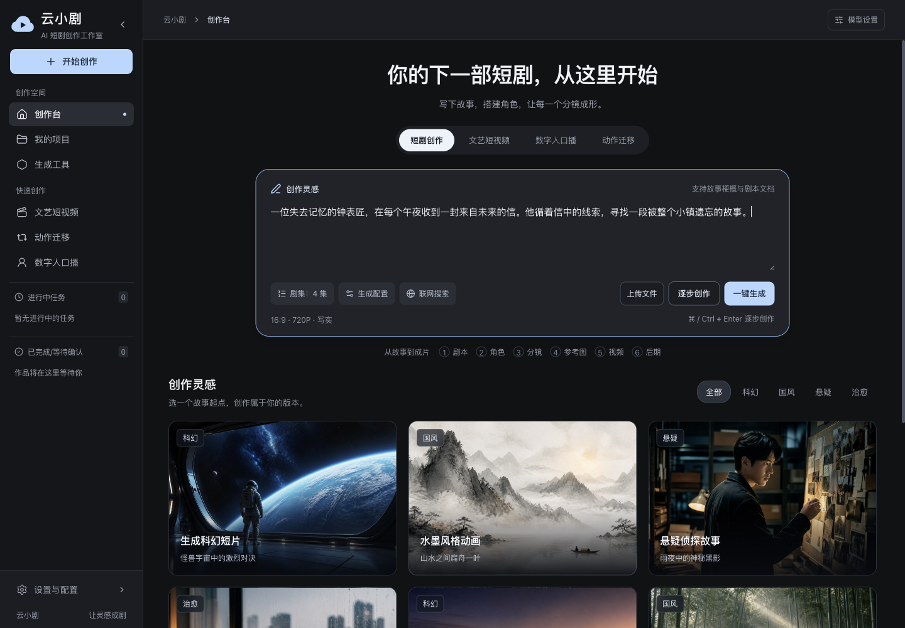

<div align="center">
  
  <h1>YunXiaoJu · 云小剧</h1>
  <p>An editable, staged AI filmmaking workspace.</p>
  <p><a href="README.md">简体中文</a> · <b>English</b> · <a href="LICENSE">MIT License</a></p>
</div>

YunXiaoJu is a locally hosted AI short-film and episodic-story workspace. It retains intermediate assets so creators can review, select versions, edit, and continue.



## Features

- Six stages: script, characters/settings, storyboard, reference images, video clips, and episode assembly.
- Step-by-step confirmation or automatic progression through completed stages.
- Asset versions, individual regeneration, script and storyboard editing.
- Artistic short-video, action-transfer, and digital-human pipelines.
- Standalone text, vision, image, and video tools.
- Configurable provider adapters, a cloud identity, dark workspace, and responsive navigation.

This is an actively developed local application. It does not currently include an infinite canvas or multi-user collaboration.

## Requirements

Python 3.10+ (3.12 recommended), Node.js 20.9+ (22 LTS recommended), npm, and ffmpeg/ffprobe for media processing. `uv` is optional. HTML template rendering requires Playwright Chromium.

```bash
git clone https://github.com/26YZT/yunxiaoju.git
cd yunxiaoju

# Backend
cd xiaoyunque/xiaoyunque/backend
python3 -m venv .venv
source .venv/bin/activate
# Windows: .venv\Scripts\activate
python -m pip install -r requirements.txt
cp config.yaml.example config.yaml
# Windows: copy config.yaml.example config.yaml
python api_server.py
```

In another terminal, from the repository root:

```bash
cd xiaoyunque/xiaoyunque/frontend
npm ci
npm run dev
```

Open **http://localhost:3000**. API documentation is at `http://127.0.0.1:8000/docs`.

For a production build:

```bash
npm run build -- --webpack
npm start
```

For HTML template rendering, run `python -m playwright install chromium` in the backend environment. The application directory also contains `install.sh` and `install.bat` helpers.

## Configuration and data

Use Settings to enter provider credentials and select default models, or edit `backend/config.yaml`. Browsing the UI does not require generating media. Actual generation requires valid provider credentials and may incur provider charges.

Local configuration, environment files, dependencies, session data, generated media, and logs are excluded from Git. Never put credentials in `config.yaml.example`.

The existing `xiaoyunque/xiaoyunque/` directory structure is retained for compatibility. Backend modules include `api/`, `core/`, `models/`, `pipelines/`, `prompts/`, `templates/`, and `tests/`. Frontend pages and shared components live in `frontend/app/` and `frontend/components/`. See [DESIGN.md](DESIGN.md) for design decisions.

## Validation and limitations

Local checks on 2026-10-07 passed TypeScript, a Webpack production build, and eight backend security tests. Six main pages and six stage components were visually checked; some stage checks used clearly labeled fixtures. Real model-driven end-to-end generation has not been validated in this pass.

Known work includes existing ESLint findings, asset-completeness checks, cancellation/restart recovery, and downstream invalidation after upstream edits. Workflow auto-progression is partly browser-driven. Background execution is not a durable job queue. The application has no authentication or tenant isolation and is intended for local use.

## Attribution and license

YunXiaoJu adapts the supplied **XiaoYunQue / Video-Claw** source with a new brand and frontend. Original MIT notices are retained in [LICENSE](LICENSE); see [NOTICE](NOTICE). Related upstream: [HITsz-TMG/VideoClaw](https://github.com/HITsz-TMG/VideoClaw).

The independent FilmAgent research archive, old promotional materials, and local-only reports are not redistributed here. Third-party model services remain subject to their own terms.
